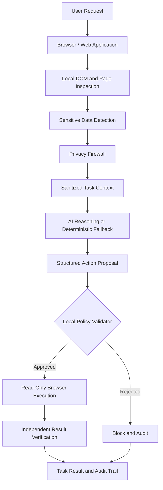

# AITHOS
### Local Privacy. Cloud Intelligence. Verified Actions.

**A privacy-preserving agent layer that helps AI understand and interact with sensitive digital environments without unnecessarily exposing personal information.**

<p align="center">
  <strong>See less. Understand enough. Act safely.</strong>
</p>

<p align="center">
  Privacy Firewall · Browser Automation · Policy Enforcement · Verifiable Audit Trail
</p>

---

## The Vision

AI agents are becoming capable of reading webpages, navigating applications, analyzing documents, and performing tasks on behalf of users.

But there is a fundamental problem: **to help us, AI often receives far more information than it actually needs.**

A banking dashboard may contain transaction records, account identifiers, contact information, and financial history. An AI agent asked to summarize expenses does not need unrestricted access to all those details.

Traditional workflows often send page content directly to a model and rely on the model to handle sensitive information responsibly.

AITHOS takes a different approach.

**Privacy should be enforced before intelligence is applied—not after information has already been exposed.**

AITHOS introduces a privacy and safety layer between the digital environment and the AI agent. It inspects relevant page content, identifies sensitive information, sanitizes the context, validates proposed actions, and verifies execution.

The result is an architecture designed to make AI agents more privacy-aware, controllable, and auditable.

---

## The Problem We Are Solving

Modern AI agents face four interconnected challenges:

- **Excessive data exposure:** An agent may receive personal information unrelated to the task.
- **Untrusted page content:** Webpages can contain misleading instructions, unexpected inputs, and dynamic content.
- **Unsafe actions:** A model-generated instruction should not automatically be trusted or executed.
- **Limited accountability:** It can be difficult to determine what data an agent accessed, why it acted, and whether the result was verified.

AITHOS addresses these challenges through a local privacy firewall, an explicit action policy, and an auditable execution pipeline.

## Our Core Innovation: The AITHOS Privacy Firewall

The Privacy Firewall is the security boundary between sensitive digital environments and AI reasoning.

Instead of treating privacy as a prompt instruction, AITHOS treats it as a processing requirement.

For each task, the system is designed to:

1. Inspect the relevant webpage structure and visible content.
2. Detect potentially sensitive information.
3. Replace identifying values with structured placeholders or remove them when unnecessary.
4. Construct a sanitized task context.
5. Use the sanitized context for reasoning.
6. Validate the proposed action against a local policy.
7. Execute only approved operations.
8. Verify the result and record an audit trail.

The key principle is simple:

> **The model may propose an action, but the local policy decides whether that action is allowed.**

The model is not the security boundary. The privacy and action-validation layers are.

---

## How AITHOS Works: End to End



### Stage 1 — Understand the task

The user gives AITHOS a natural-language instruction, such as:

“Sort my transactions by largest expense and summarize my spending without exposing personal details.”

AITHOS maps the request to a supported operation rather than granting the model unrestricted control of the browser.

### Stage 2 — Inspect the digital environment

The browser connector inspects the relevant webpage and extracts the information required for the task.

The prototype uses browser automation through Playwright for rendered pages, including pages whose content is created by JavaScript.

Only the relevant content should be included in the task context.

### Stage 3 — Detect sensitive information

The privacy engine scans the extracted content for potentially identifying values.

Current detector patterns cover categories such as:

- Email addresses
- Phone numbers
- Account identifiers
- Payment-card-like numbers
- Government-identification patterns
- Passwords and PIN-like values

Detection is pattern-based in the current implementation. More advanced semantic, visual, OCR, and context-aware detectors are possible extensions.

### Stage 4 — Sanitize before reasoning

The sanitizer replaces detected values with structured tokens, for example:

| Original category | Sanitized representation |
|---|---|
| Email address | `<EMAIL_1>` |
| Phone number | `<PHONE_NUMBER_1>` |
| Account identifier | `<ACCOUNT_NUM_1>` |
| Government ID | `<GOVERNMENT_ID_1>` |

Personal names and other identifying information must also be removed or masked where appropriate.

Sanitization must apply to the complete model input—not only the visible transaction table. Prompts, metadata, intermediate context, and logs must be reviewed as well.

Where a task requires amounts or transaction types, those values can remain available to the reasoning process if they are necessary and do not independently expose prohibited information.

### Stage 5 — Reason over the sanitized context

The AI reasoning component can propose a structured action using sanitized information.

The current prototype supports a deterministic fallback when local model inference is unavailable. This allows supported operations to proceed without pretending that a failed model generated a response.

A reachable model server is not proof that inference is healthy. AITHOS should distinguish between model-server availability, successful inference, and deterministic execution.

### Stage 6 — Enforce the action policy

Every proposed action passes through a local policy validator.

The current action set includes operations such as:

- Inspect transactions
- Sort by amount
- Calculate a summary
- Filter by date
- Search a statement

The policy rejects prohibited operations such as transferring funds, sending money, changing passwords, or modifying beneficiaries.

**A model response is never sufficient authorization to execute a sensitive action.**

### Stage 7 — Execute and verify

Approved operations are executed through the browser connector.

AITHOS should verify the resulting page state rather than relying only on the model's claim that an action succeeded.

For example, when sorting transactions, the system should inspect the resulting rows and independently check the required order.

Expense ranking must distinguish debits from credits; a large incoming payment must not be reported as the largest expense.

### Stage 8 — Record an auditable result

The execution timeline records meaningful steps, their rationale, validation outcomes, and verification results.

The audit trail is designed to answer:

- What did the user request?
- Which action was proposed?
- Why was that action permitted or blocked?
- What privacy checks were applied?
- Did execution succeed?
- Was the result independently verified?

Audit records should avoid storing raw personal identifiers or unnecessarily sensitive source content.

---

## The AITHOS Demo

The prototype uses a synthetic banking environment to demonstrate privacy-preserving browser automation.

### Example task

“Sort my transactions by largest expense and summarize my spending without exposing personal details.”

### Expected execution

1. AITHOS accepts the user's instruction.
2. The action validator approves the requested read-only operation.
3. The browser connector opens the configured banking sandbox.
4. The agent inspects the rendered transaction records.
5. The privacy engine sanitizes identifying information.
6. The agent ranks expense transactions in descending order.
7. AITHOS calculates a summary from the relevant records.
8. The system verifies the resulting order and calculations.
9. The frontend displays the execution timeline and final result.

### What makes this demo different?

The goal is not merely to demonstrate that an AI can sort a table.

The goal is to demonstrate the controls around the action:

- Privacy checks before reasoning
- Explicit action authorization
- A visible distinction between model inference and deterministic fallback
- Independent result verification
- An audit trail with a rationale for each meaningful step

All demonstrations should use synthetic data. The prototype must report connection failures honestly rather than substituting local sample records while claiming to have controlled a live website.

---

## System Architecture

| Component | Responsibility |
|---|---|
| React + Vite frontend | Agent workspace, task execution, status indicators, timeline, privacy view, and audit interface |
| FastAPI backend | API endpoints, task lifecycle, settings, execution coordination, and event streaming |
| Browser connector | Browser navigation, DOM inspection, supported actions, and result verification |
| Privacy detector | Pattern-based detection of potentially sensitive values |
| Sanitizer | Replacement or removal of sensitive values before reasoning |
| Action validator | Local allowlist and rejection of prohibited operations |
| AI client | Model availability checks, inference attempts, and transparent fallback handling |
| Task manager | Coordinates task stages and records execution events |
| Playwright + Chromium | Automated interaction with rendered browser pages |
| Test suite | Regression tests for API behavior, privacy handling, policy enforcement, and browser integration |

### Current task lifecycle

The backend organizes execution into stages such as:

`INIT → ACTION_VALIDATION → DOM_INSPECTION → PRIVACY_SCAN → AI_INFERENCE → EXECUTION → COMPLETED`

Failures, blocked actions, and unavailable dependencies should be represented explicitly rather than hidden behind a success status.

---

## Technology Stack

**Frontend**
- React
- TypeScript
- Vite
- Tailwind CSS

**Backend**
- Python
- FastAPI
- Playwright
- Chromium

**AI and privacy**
- Ollama-compatible local inference
- Deterministic fallback for supported operations
- Pattern-based PII detection and sanitization
- Local action-policy validation

**Testing and development**
- Pytest
- Frontend production builds through Vite
- Git and GitHub

Browser-native inference technologies such as WebAssembly, WebGPU, and ONNX Runtime Web are potential extensions for future versions; they should not be interpreted as fully implemented capabilities unless separately integrated and tested.

---

## Project Structure

The following is a conceptual overview of the principal project areas. Exact filenames may evolve as the implementation develops.

```text
Aithos agent/
├── backend/
│   ├── app/
│   │   ├── agent/
│   │   │   ├── browser_connector.py
│   │   │   ├── task_manager.py
│   │   │   └── action_validator.py
│   │   ├── privacy/
│   │   │   ├── detector.py
│   │   │   └── sanitizer.py
│   │   ├── ai/
│   │   │   └── ollama_client.py
│   │   ├── api/
│   │   │   └── routes.py
│   │   └── main.py
│   └── tests/
│       ├── test_action_validator.py
│       ├── test_api.py
│       ├── test_detector.py
│       ├── test_sanitizer.py
│       ├── test_task_manager.py
│       └── test_playwright_integration.py
├── frontend/
│   ├── src/
│   │   └── pages/
│   │       ├── WorkspacePage.tsx
│   │       └── SettingsPage.tsx
│   └── package.json
├── .gitignore
└── README.md
```

The FakeBank demo may be maintained in a separate nested Git repository. Its history should remain separate from the AITHOS repository unless a deliberate repository migration is planned.

---

## Getting Started

### Prerequisites

- Python and pip
- Node.js and npm
- Git
- A supported desktop operating system
- Chromium installed through Playwright for browser automation

Use the Python environment and package versions already established by the project where possible.

### 1. Clone or open the repository

```bash
git clone <YOUR_AITHOS_REPOSITORY_URL>
cd "Aithos agent"
```

If you already have the project locally, open the existing repository instead of cloning it again.

### 2. Start the backend

In PowerShell, from the project root:

```powershell
.\backend_venv\Scripts\uvicorn backend.app.main:app --host 127.0.0.1 --port 8000 --reload
```

The API should be available at:

- Health endpoint: `http://127.0.0.1:8000/api/health`
- API documentation: `http://127.0.0.1:8000/docs`

If your Python environment is missing dependencies, install the project's declared dependencies before starting the service.

### 3. Start the frontend

Open a second terminal:

```powershell
cd frontend
npm install
npm run dev
```

Open the local URL printed by Vite, normally:

`http://localhost:5173`

### 4. Configure the browser target

Open AITHOS Settings and select the appropriate sandbox target.

The deployed demonstration environment is:

`https://securebank-sandbox.onrender.com`

The backend must use the same configured target. A successful frontend status check alone does not prove that browser automation is connected to the correct page.

### 5. Execute the demo

Open Agent Workspace and select the banking demonstration task.

Inspect the timeline to confirm:

- The intended target URL is used.
- Browser navigation and transaction inspection succeed.
- Privacy sanitization runs before reasoning.
- The action is approved by the local policy.
- The browser operation is executed.
- The result is independently verified.
- The final output corresponds to the inspected records.

If a dependency is unavailable, resolve the underlying issue before claiming a successful live demo.

---

## Testing

Run the backend tests:

```powershell
.\backend_venv\Scripts\pytest backend\tests -v
```

Build the frontend:

```powershell
cd frontend
npm run build
```

### Important test categories

A robust test suite should cover:

- Detection of supported sensitive-data patterns
- Sanitization of names and identifiers
- Absence of raw PII in model requests and audit logs
- Rejection of prohibited actions
- Correct sorting of mixed debit and credit transactions
- Handling of negative, zero, and missing amounts
- Correct summaries for empty and non-empty datasets
- Browser connection failures
- Verification against the actual resulting browser state
- Honest reporting when model inference fails
- End-to-end execution against a controlled synthetic environment

Passing unit tests is necessary, but it does not by itself prove that the deployed browser integration works correctly.

---

## Security Principles

AITHOS is designed around the following principles.

### 1. Minimize data exposure

Only task-relevant information should be processed by the reasoning component.

### 2. Enforce privacy before inference

Sanitization must happen before the model receives the task context. Prompt instructions alone are not a privacy control.

### 3. Treat external content as untrusted

Webpage text, embedded instructions, and model-generated proposals must not override the local security policy.

### 4. Keep execution under local control

Actions must pass explicit validation before execution. The model must not be able to bypass the validator.

### 5. Verify rather than assume

A successful model response is not proof that a browser action succeeded.

### 6. Audit without leaking

Record decisions and outcomes while minimizing the sensitive information retained in logs.

### 7. Fail honestly

If a browser, model, or external service is unavailable, report the failure and avoid presenting a simulated result as a live operation.

---

## Threat Model and Limitations

AITHOS is a prototype, not a guarantee of complete privacy or security.

Potential risks include:

- Sensitive information that the current detector does not recognize
- OCR or visual-detection errors
- Identifiers embedded in unusual formats or page metadata
- Dynamic websites whose structure changes unexpectedly
- Malicious webpage content or prompt injection
- Sensitive information retained by browser tools, debugging output, or third-party services
- Model-generated actions that are incorrect or ambiguous
- Browser automation failures or stale page state

Pattern-based detection cannot guarantee that every sensitive value will be found. Sanitization must be tested against realistic adversarial and edge-case inputs.

A local privacy layer also does not automatically eliminate every external data flow. Network requests, telemetry, model payloads, logs, and browser state must be inspected and tested.

**AITHOS should claim only the privacy and safety properties demonstrated by its implementation and tests.**

---

## What Makes AITHOS Different?

Many agent frameworks focus on what an AI agent can do.

AITHOS focuses on what the agent should be allowed to know and do.

Its distinguishing approach combines:

**Privacy before intelligence**  
Sensitive context is sanitized before it reaches the reasoning component.

**Policy before execution**  
Proposed actions are checked against explicit local rules.

**Evidence after execution**  
The result is checked against the browser's actual state.

**Transparency throughout**  
The execution timeline explains what happened and why.

This creates a practical foundation for privacy-aware automation in financial applications, healthcare workflows, enterprise software, legal systems, and other environments where unnecessary disclosure is a serious concern.

---

## Roadmap

### Phase 1 — Reliable browser-agent foundation
- [ ] Complete deployed sandbox integration
- [ ] Persist and verify browser target configuration
- [ ] Correctly distinguish expenses from incoming credits
- [ ] Remove names and other identifying values from sanitized model context
- [ ] Improve model-health and fallback indicators
- [ ] Verify all results against actual browser state

### Phase 2 — Stronger privacy protection
- [ ] Context-aware entity detection
- [ ] DOM and visual/OCR detection fusion
- [ ] Redaction regression and adversarial test datasets
- [ ] Verification of every outbound model payload
- [ ] Privacy leakage metrics and reproducible benchmarks

### Phase 3 — Safer agent execution
- [ ] Typed, schema-validated action contracts
- [ ] Protection against prompt injection
- [ ] Stronger origin and page-context validation
- [ ] Explicit approval for sensitive or irreversible operations
- [ ] More comprehensive failure recovery and audit integrity

### Phase 4 — Production-oriented deployment
- [ ] Browser extension integration
- [ ] Support for configurable enterprise policies
- [ ] Organization-level audit and access controls
- [ ] Independent security review
- [ ] Performance, reliability, and privacy evaluation

Roadmap items describe planned work, not currently available features.

---

## Measuring Success

AITHOS should be evaluated using reproducible measurements rather than unsupported claims.

| Evaluation | What it measures |
|---|---|
| PII recall | How many sensitive values are detected |
| PII precision | How often detections are correct |
| Leakage rate | How often raw sensitive values appear in outbound payloads |
| Action-policy compliance | Whether prohibited actions are consistently blocked |
| Verification accuracy | Whether reported outcomes match actual browser state |
| Task success rate | Whether supported tasks complete correctly |
| Latency | Time required for inspection, sanitization, reasoning, and execution |
| Resource usage | CPU, memory, and model-inference requirements |

Results should be reported with a defined dataset, test procedure, and clear limitations.

---

## Intended Applications

AITHOS could serve as a privacy layer for:

- Financial dashboards and expense analysis
- Healthcare administration workflows
- Enterprise browser automation
- Legal-document workflows
- Personal productivity agents
- AI assistants operating on sensitive internal applications

These are intended application areas, not claims of production certification or deployment.

---

## Contributing

Contributions that improve privacy, safety, reliability, or reproducibility are especially welcome.

1. Create a focused change.
2. Add regression tests for the behavior.
3. Verify that sensitive information does not leak through logs or model requests.
4. Run the backend tests and frontend build.
5. Document any limitations or new configuration requirements.

Never submit real banking credentials, personal documents, API keys, or production customer data in issues, tests, or pull requests.

---

## Responsible Use

AITHOS is an experimental privacy-preserving browser-agent prototype. It is not a substitute for a security audit, regulatory assessment, or production-grade financial authorization system.

Use synthetic data for demonstrations. Do not enable autonomous financial transactions or other irreversible actions without appropriate security controls, explicit authorization, and independent review.

---

## Closing Note

**AI should not need to know everything about you to help you.**

AITHOS is built around a different model of agent intelligence: give the system the minimum information required, keep action authorization under explicit control, and verify what happens.

The future of AI agents should not depend on choosing between usefulness and privacy.

**With AITHOS, our goal is to make privacy part of the architecture—not an afterthought.**

<p align="center">
  <strong>AITHOS — Local Privacy. Cloud Intelligence. Verified Actions.</strong>
</p>
